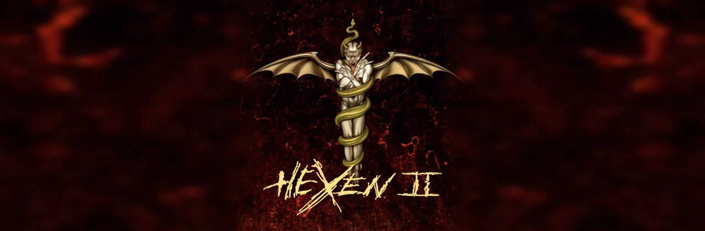

<div align="center">



# HeXen2NX

**HeXen II on Nintendo Switch**

Unofficial Nintendo Switch port of **HeXen II** (1997), built on the
[uHexen2](https://github.com/sezero/uhexen2) source port.

[](#)
[](#)
[-8A2BE2?style=for-the-badge)](docs/renderer.md)
[](LICENSE)

</div>

---

The game's own files are not included: the port runs on your copy of the game.

This is an early build. It draws with the CPU, as a first step, while the native
deko3D renderer is on its way. See [docs/status.md](docs/status.md) for what has
been checked and how.

## What you need

- A Switch with Atmosphère and a homebrew menu (hbmenu or
  [sphaira](https://github.com/ITotalJustice/sphaira))
- Your own copy of **HeXen II**, patched to version 1.11 (GOG's copy already is)
- About 230 MB free on the SD card

## Installing

1. Copy `HeXen2NX.nro` to `sd:/switch/HeXen2NX/`.
2. From the game's folder on your PC, copy `data1` into the same folder, and
   `music` too if your copy has it.
3. Start **HeXen II** from the homebrew menu.

The first start puts the music where the engine looks for it and sets aside the
settings of a PC, once.

For **Portal of Praevus**, add its `portals` folder next to `data1`. The port
finds it and starts the expansion on its own.

## Controls

| Switch | Game |
| --- | --- |
| Left stick | Move |
| Right stick | Look |
| ZR | Attack |
| ZL or A | Jump |
| B | Crouch |
| L / R | Previous / next inventory item |
| X | Use the selected item |
| Y or D-pad right | Next weapon |
| D-pad left | Previous weapon |
| D-pad down | Drop the selected item |
| D-pad up | Scores (multiplayer) |
| − | Character and inventory screen |
| + | Menu |
| Left stick click | Walk |
| Right stick click | Center the view |

In the menus, the D-pad or the left stick moves, **A** chooses, **B** goes back
and **X** erases a letter. Every button can be changed in **Options ›
Customize Controls**. Stick speed and dead zone are the `joy_` settings in
`data1/config.cfg`.

## Settings

`sd:/switch/HeXen2NX/args.txt`, if you create it, holds command line arguments for
the engine, like `-noportals` to leave the expansion out.

## Reporting a problem

Open an issue with `hexen2_log.txt` (and `hexen2_crash.txt`, if there is one) from
`sd:/switch/HeXen2NX/SD_LOG/`.

## Building

GitHub Actions builds every push (`.github/workflows/build.yml`); the
`HeXen2NX_sd` artifact is the SD card layout. Locally, with
[devkitPro](https://devkitpro.org/wiki/Getting_Started):

```bash
dkp-pacman -S switch-dev switch-cmake deko3d uam switch-libogg switch-libvorbisidec
./build_nx.sh
python tools/package_sd.py "/path/to/your/copy/of/HeXen II"
```

The first builds the NRO into `SD_CARD/`, the second adds the game's files to it,
ready to copy to the card. [tools/hostcheck](tools/hostcheck/README.md) runs the
port on a PC, for testing without a console.

## Credits

- [uHexen2 (Hammer of Thyrion)](https://github.com/sezero/uhexen2) by O. Sezer and
  contributors: the source port this is built on
- Raven Software and id Software: the game and its released source code
- [devkitPro](https://devkitpro.org/): devkitA64, libnx and deko3D

## Disclaimer

HeXen II is a trademark of its respective owners. This project is not affiliated
with, endorsed or sponsored by them. It contains no game data. The icon and the
banner show the game's cover art, to identify the game.

## License

GPL-2.0, see [LICENSE](LICENSE).
